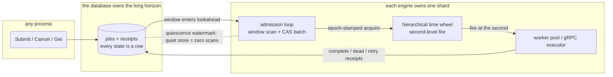
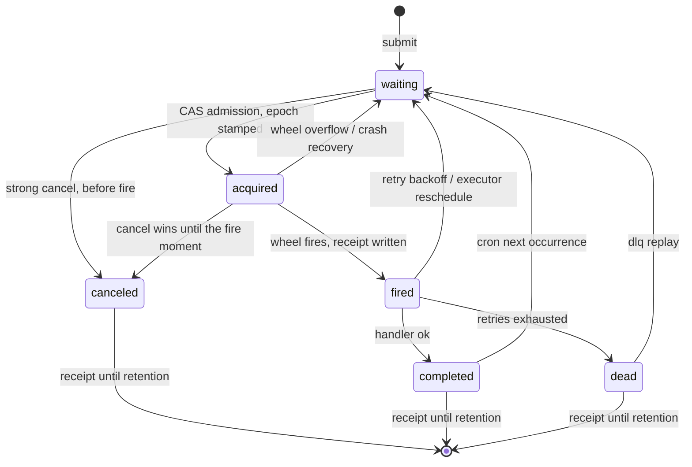
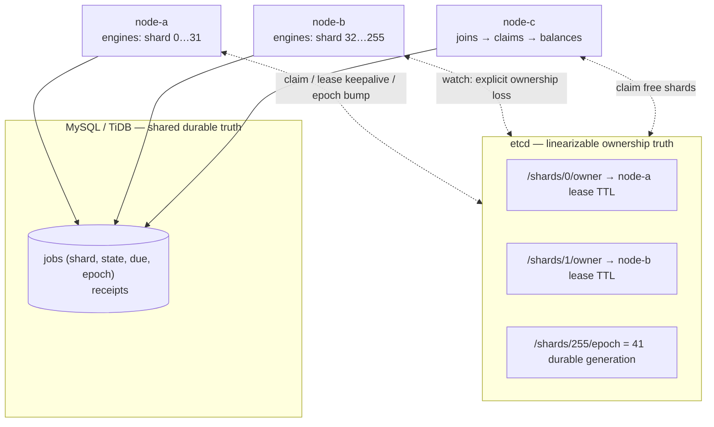
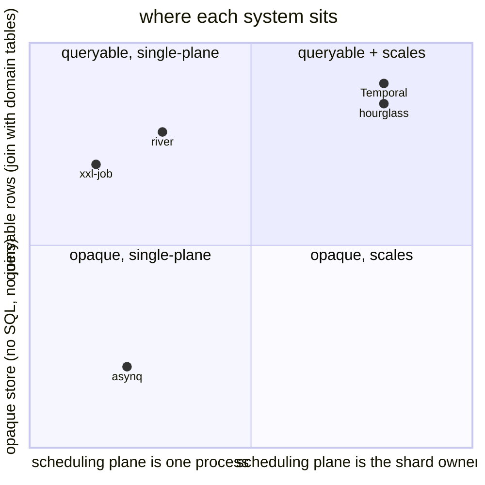

# hourglass

Delayed jobs and cron for Go: start in 30 seconds on SQLite, scale to a
sharded cluster without changing the engine.

```go
h, _ := hourglass.Open("sqlite://./hourglass.db")
defer h.Close()

h.Register("email:welcome", handler)
h.Submit(ctx, "email:welcome", payload, hourglass.Delay(24*time.Hour))
h.Every(ctx, "report:daily", "0 9 * * *")   // cron, registered handler
h.Cancel(ctx, id, "user asked")             // wins until the fire moment

go h.Run(ctx)                               // 1s ticks: admit -> wheel -> fire
```

Inspect and operate from the CLI (reads the same store):

```
$ hourglass stats
jobs by state:
  waiting    1204
  completed  8891
  dead       3
receipts: 17802
oldest terminal kept: 2d18h (ago)

$ hourglass dlq ls --topic report:daily
9f3c...  report:daily  attempts=3  due=2026-10-31T09:00:00Z

$ hourglass dlq replay 9f3c...
replayed 9f3c...
```

No broker, no coordinator, no services to run. When the workload
outgrows one process, point the same code at MySQL and add etcd — the
engine, the data model, and the API stay identical.

## Why

Most Go task systems make you choose: a cache masquerading as a task
store (asynq — Redis, no transactional audit trail), one database
dialect with poll-based precision (river — PostgreSQL), or a central
dispatcher serializing on one task table (xxl-job-style). hourglass
splits the timing contract instead:

- The database keeps the long horizon: every job is auditable,
  cancelable, and recoverable in SQL you can query.
- The time wheel keeps the precision: an in-process hierarchical wheel
  fires jobs at second-level accuracy — no polling interval, no broker
  in the hot path.
- The state machine keeps the honesty: admission is a CAS, delivery is
  at-least-once with idempotent handlers, dead letters are rows you can
  list and replay from the CLI.

The scale story is the same design, not a rewrite: partitioned scans on
MySQL/TiDB, one admission loop per partition, nodes leasing partitions
through etcd with epoch-fenced handoff and misfire rescans. The
architecture was proven in a production system that replaced xxl-job
and peaked above 200K execution commands per second — that story, and
the failures that shaped it, is documented here:
[Building a Production Go Scheduler for 200K+ Delayed Jobs per Second](https://edwardshen125.github.io/posts/engineering-case-study/building-a-production-go-scheduler-for-200k-delayed-jobs-per-second/).





The production ancestors and design trade-offs behind each mechanism:
[docs/lessons.md](docs/lessons.md).

## Measured (v1.0 benchmarks, fake clock, in-repo and reproducible)

| benchmark | hourglass | poll-based baseline |
| --------- | --------- | ------------------- |
| fire precision p50 / p99 / max (5,000 jobs / 10 min) | **0 / 0 / 1000 ms** (1s tick) | 2,000 / 4,000 / 5,000 ms (5s poll) |
| quiescent reads, 10 min idle, 100K pending | **2** (admission watermark) | 121 (one scan per interval, forever) |
| hot minute: 100K jobs due the same second | **11.1s drain, 0.02 write stmts/job, zero loss/duplication** | unbatched path would issue 4+ writes/job |

All three are gated tests (`-run TestBenchmark`), not logged demos:
regressing the wheel to poller-grade precision or losing the quiescence
watermark fails the suite. The 100K hot minute found a real defect on
its first run — every batched id-list statement exceeded SQLite's
placeholder cap above ~8K ids and the batch silently stalled; all
id-list statements now chunk at 500 per round-trip.

## Contracts

- Jobs fire at the appointed second — never early, never skipped. The
  wheel holds the admitted slice in memory; the database holds the
  truth. In-memory state is a cache, never the owner.
- Jobs never orphan. Delivery is at-least-once with idempotent
  handlers; a crashed node's in-flight jobs are reclaimed by lease
  expiry and re-fired within the misfire horizon — no stuck-active
  states, no manual cleanup.
- Cancellation actually cancels. Until the fire moment, cancel wins —
  and epoch fencing stops a zombie node's late shots from resurrecting
  a canceled job.
- Dead letters are queryable rows. `hourglass dlq ls`, `hourglass dlq
  replay` — no lost topics, no console required.

## Status

Pre-1.0, private until launch-ready. The embedded engine is complete
and measured (see above); cluster mode is the remaining v1.0 work. Built
to the enterprise bar (audit, fencing, HA handoff), entered through the
30-second start; the build blueprint is [DESIGN.md](DESIGN.md), the
production lessons behind it are in [docs/lessons.md](docs/lessons.md).
v1.0 scope:

- [x] Embedded core: SQLite storage, single-node admission loop
- [x] Hierarchical time wheel, second-level fire precision
- [x] Delayed jobs + cron, typed handler API
- [x] Dispersion (jitter) windows per schedule
- [x] Retention: terminal-row TTL, background purge, size metrics
- [x] Execution log: attempts, receipts in core schema
- [x] Retry policy: per-job attempts, backoff requeue, dead letters
- [x] Crash recovery: in-flight rows requeued at Open
- [x] CLI: `stats`, `dlq ls`, `dlq replay`
- [x] Benchmarks: fire precision, quiescence, hot minute (gated tests)
- [ ] Cluster storage: MySQL/TiDB partitioned scans, CAS admission
- [ ] Cluster coordination: etcd shard registry, epoch-fenced handoff,
      misfire rescan
- [ ] Executor SDK (gRPC): registration, heartbeat, idempotency



Adding node-c claims free shards: **scheduling throughput grows with
nodes** — no leader, no failover service, no data movement (migration
moves scan ownership only).

Post-1.0, on demand: an MCP agent face (`hourglass mcp`, declarative
webhook targets, self-chaining acks, event-anchored delays, debounce
windows) — durable time for agents that cannot hold their own
futures — plus delayed-queue delivery backends (Pulsar, RocketMQ 5.x
`deliver-at`) for deployments that already run a broker.

## Comparison



Positions are qualitative judgments (two of seven dimensions — the
table below carries the falsifiable rest). The interesting neighbor is
river: near-identical truth model (full PG rows, transactional
enqueue), and the entire difference is the x-axis — one elected leader
advances scheduled jobs, versus one admission loop per shard owner.
That, not storage, is where the designs diverge.

What happens on the hot path when a job becomes due:

```mermaid
flowchart TB
    subgraph A["asynq"]
        A1["scheduled zset"] -->|"EVERY server runs its own forwarder
        (5s default, redundant scans)"| A2["live queue"] --> A3["worker"]
    end
    subgraph R["river"]
        R0["scheduled rows"] -->|"elected LEADER advances them
        (scheduler service)"| R1["available rows"]
        R1 -->|"fetch: NOTIFY doorbell + 1s poll
        SKIP LOCKED claims"| R2["worker"]
    end
    subgraph X["xxl-job"]
        X1["central dispatcher"] -->|serializes on one table| X2["trigger"] --> X3["executor"]
    end
    subgraph H["hourglass"]
        H1["window enters lookahead"] -->|"CAS batch (epoch)"| H2["wheel fires
        at the second"] --> H3["handler / gRPC executor"]
        H1 -. "quiet store: watermark, zero scans" .- H1
    end
```



|              | asynq          | river            | xxl-job        | Temporal         | hourglass          |
| ------------ | -------------- | ---------------- | -------------- | ---------------- | ------------------ |
| truth        | Redis zset     | PG rows          | SQL + logs     | sharded history  | SQL rows + receipts|
| precision    | 5s forwarder   | ~1s (leader scheduler + fetch) | dispatch loop | timer gate at the timestamp (wake = workflow callback through 3 hops) | time wheel (0ms p50 @ 1s tick; handler in process) |
| scheduling plane | every server (redundant forwarders) | elected leader | central dispatcher (SPOF) | shard owners | shard owners |
| scale-out    | execution only | execution only   | dispatcher-bound | shards (fixed at boot) | shards (movable, no data moves) |
| cron durability | scheduler process memory | leader memory — may skip on election (durable = Pro) | DB rows | event history | job row (completed → waiting) |
| cancel       | until claimed  | even while running (cooperative) | manual | workflow-level | until fire moment (epoch-fenced) |
| dependency   | Redis          | PostgreSQL       | DB + central   | 4 services + DB  | the SQL you run    |

One line each, honestly:

- **asynq** — great Redis-backed queue with a UI; every server runs its
  own 5s forwarder over the scheduled zset, and the audit trail is Redis.
- **river** — great Postgres-native queue; transactional enqueue is a
  genuinely nice property, and in-flight cancellation works. But the
  scheduling plane is one elected leader (scheduled jobs stall until a
  new leader; periodic jobs live in leader memory and can skip —
  durable periodic is a Pro feature).
- **xxl-job** — battle-tested console; a central dispatcher on one
  table is the bottleneck the ancestor system replaced in production.
- **Temporal** — the same shard-owner + fencing-generation model (its
  RangeID is our epoch; verified in source), carrying a workflow engine
  on top: timers wake workflow callbacks through the
  history→matching→worker pipeline, shards own workflow runs and are
  fixed at cluster creation, and fencing lives in a DB row lock (one
  documented thundering-herd failure mode) rather than a coordinator.
  Durable execution is the product; a durable timer shouldn't need it.
  Deep dive with file-level sources:
  [docs/research-temporal.md](docs/research-temporal.md).
- **hourglass** — durable *time* as a library: SQL truth, wheel
  precision, scheduling that grows with nodes. Not a workflow engine,
  by design — compose it with Temporal when you need replay.

(Fuller notes with sources: [docs/lessons.md](docs/lessons.md) #11–12.)

## License

MIT
