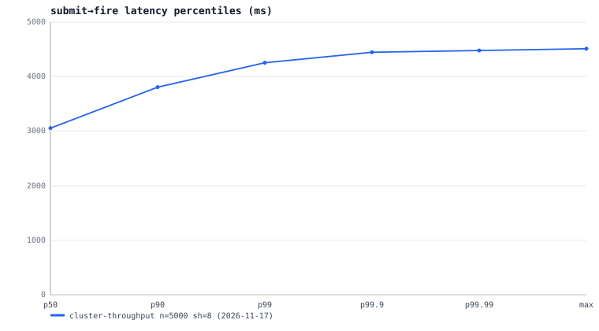
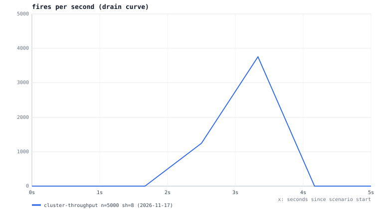

# Measurement protocol

How numbers in this repository are produced, compared, and archived.
Two tiers: engine benchmarks (anywhere, no services) and cluster
scenarios (real MySQL + etcd). Both feed `benchstat`.

## Tier 1 — engine benchmarks (SQLite, zero dependencies)

Standard `testing.B` benchmarks on the embedded engine:

- `BenchmarkSubmit` — the durable-submit path (one INSERT round trip
  per job, by design).
- `BenchmarkFirePath` — the batched fire pipeline end to end
  (admission → CAS → wheel tick → dispatch → batched transitions +
  receipts); one op = 1000 jobs, reported as `jobs/op`.

Regression workflow:

```sh
go test -run '^$' -bench 'Benchmark(Submit|FirePath)' -count 10 > old.txt
# ... change something ...
go test -run '^$' -bench 'Benchmark(Submit|FirePath)' -count 10 > new.txt
benchstat old.txt new.txt
```

`-count 10` is the floor: benchstat itself will say when there are
not enough samples for a confidence interval. Do not compare single
runs.

## Tier 2 — cluster scenarios (real MySQL + etcd)

`cmd/hourglass-bench` runs load scenarios against real infrastructure
(versions pinned in docs/loadtest-report.md):

```sh
docker run -d --name hg-mysql -p 33061:3306 \
  -e MYSQL_ROOT_PASSWORD=hgtest -e MYSQL_DATABASE=hourglass mysql:8.4
docker run -d --name hg-etcd -p 23791:2379 \
  gcr.io/etcd-development/etcd:v3.5.17 \
  etcd --listen-client-urls http://0.0.0.0:2379 \
       --advertise-client-urls http://0.0.0.0:2379

TEST_MYSQL_DSN='root:hgtest@tcp(127.0.0.1:33061)/hourglass' \
TEST_ETCD_ADDR=127.0.0.1:23791 \
  hourglass-bench -s cluster-throughput -n 20000 -shards 16
```

Output, per scenario:

1. **Human table** — throughput, loss, and the submit→fire latency
   percentiles (p50/p90/p99/p99.9/p99.99/max).
2. **benchstat lines** — `Benchmark…Submit`/`…Fire` in `go test`
   format; concatenate runs and diff with benchstat as in Tier 1.
3. **JSON artifact** — `bench-results/<scenario>-<timestamp>.json`
   with the full HDR histogram export (re-quantile later at any
   percentile), the scalar percentiles, the per-second fire curve,
   rates, and environment. Artifacts are local; `bench-results/` is
   gitignored.

## Charts

`cmd/benchplot` renders deterministic SVG charts from artifacts
(flags before file arguments — Go's flag package stops at the first
positional arg):

```sh
go build -o benchplot ./cmd/benchplot
benchplot -mode percentile -o docs/charts/latency.svg bench-results/*.json
benchplot -mode fire       -o docs/charts/fire.svg   bench-results/*.json
```

- `percentile` — submit→fire latency curve (p50→max) per artifact,
  one series each: tail shape at a glance.
- `fire` — per-second fire counts, zero-padded past the last fire so
  the drain visibly completes.

Committed examples (generated from the 2026-11-17 cluster-throughput
run, n=5000, shards=8, MySQL 8.4 + etcd 3.5.17 on one laptop):





Charts are regenerated, never hand-edited; the artifact is the source
of truth and the SVG is a pure function of it.

## Why HDR and source-anchored latency

- Latency percentiles come from an HDR histogram (2 significant
  digits), so p99.9 vs p99.99 is a real measurement, not an
  interpolation between two samples.
- Each job's submit→fire delta is anchored at the job's own Submit
  return and closed at its fire (per-id map, not a sampling thread):
  under load bursts there is no coordinated omission from the
  measuring side — jobs that wait long are all counted.
- Absolute numbers on one laptop are shape, not fleet grade; the
  protocol's claim is reproducibility (same seed commands, pinned
  infra, archived histograms), not leaderboard placement.

## Gates vs measurements

The fake-clock gates in `bench_test.go` (precision, quiescence,
hot-minute drain) remain the CI pass/fail line. Everything on this
page is the measurement discipline around them: gates catch
regressions, benchstat quantifies them, HDR describes their shape.
